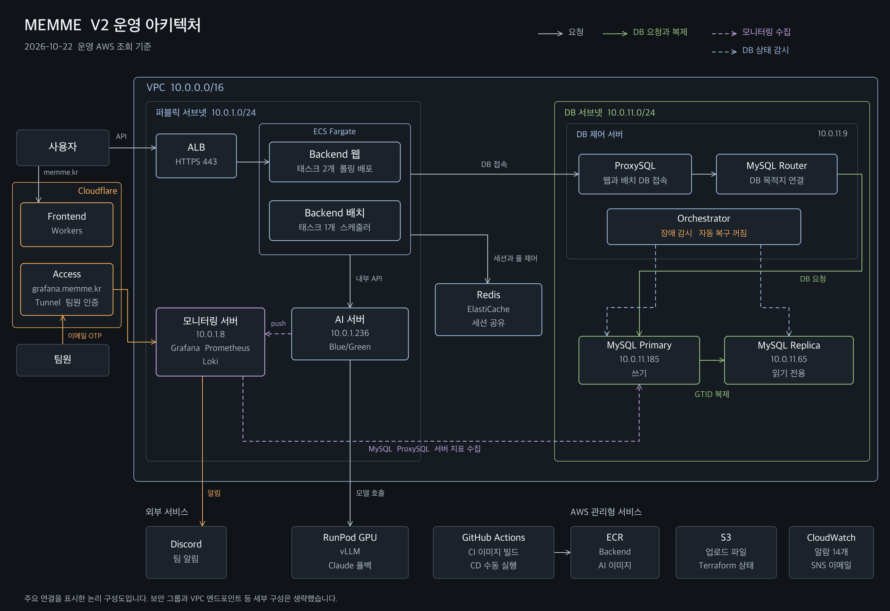

# KTB4-7th-Cloud

맴매 서비스의 V2 운영 인프라와 Backend·AI·Frontend 배포 구성을 관리하는 Repository입니다.

V1은 EC2 한 대 안의 Blue/Green 배포와 RDS로 운영했습니다. V2에서는 Backend를 ECS Fargate로 옮기고, DB를 EC2 MySQL Primary·Replica로 이전했으며, 장애 감지를 위한 모니터링을 추가했습니다.

## 아키텍처



주요 연결만 표시한 논리 구성도입니다. 보안 그룹과 VPC 엔드포인트 같은 세부 구성은 생략했습니다. 2026-10-22 운영 AWS 조회 결과를 기준으로 그렸습니다.

## V2 운영 구성

| 영역 | 구성 | 역할 |
| --- | --- | --- |
| Frontend | Cloudflare Workers `memme-fe` | 정적 파일 제공 (`https://memme.kr`) |
| 진입점 | ALB `memme-v2-alb` | HTTPS 종료, `https://api.memme.kr` 요청을 웹 태스크로 전달, `/internal/*` 외부 요청 차단 |
| Backend 웹 | ECS Fargate 태스크 2개 (1 vCPU, 2 GB) | API 처리. 롤링 배포 100/200, circuit breaker 자동 롤백 |
| Backend 배치 | ECS Fargate 태스크 1개 | 스케줄러 단독 실행 (ASOS 날씨, 서울 상권 수집 등). ALB 미등록 |
| AI | EC2 1대 (t3.medium) | 같은 EC2 안 Blue/Green 컨테이너. RunPod GPU(vLLM) 호출, 실패 시 Claude API로 폴백 |
| 내부 호출 | Cloud Map `memme.internal` | AI 서버가 Backend 내부 API를 호출하는 사설 경로 |
| 세션·풀 제어 | ElastiCache Redis (TLS, 전용 사용자) | 웹 2개의 로그인 세션 공유, 웹·배치 DB 연결 풀 제어 |
| DB | EC2 MySQL 8.4 Primary 1대, Replica 1대 | GTID 복제, TLS 접속. Replica는 읽기 전용 |
| DB 제어 서버 | EC2 1대 | ProxySQL(앱 접속), MySQL Router(목적지 연결), Orchestrator(상태 감시) |
| 모니터링 | EC2 1대 (t3.small) | Grafana, Prometheus, Loki. Cloudflare Tunnel로 `grafana.memme.kr` 접속 |
| 이미지 | ECR `memme/backend`, `memme/ai` | 서비스 저장소 CI가 커밋 SHA 태그로 게시 |
| 파일 | S3 | 매출 업로드 원본, Terraform 원격 state |
| 비밀값 | Secrets Manager, SSM Parameter Store | 서비스 런타임 환경변수, 모니터링 자격 정보 |

### 네트워크

| 서브넷 | 배치 |
| --- | --- |
| 퍼블릭 `10.0.1.0/24`, `10.0.2.0/24` | ALB, ECS 태스크, AI 서버, 모니터링 서버 |
| DB `10.0.11.0/24`, `10.0.12.0/24` | MySQL Primary·Replica, DB 제어 서버 |

NAT Gateway는 사용하지 않습니다. DB 서브넷은 인터넷 경로 없이 S3·SSM VPC 엔드포인트만 사용하고, 서버 접속은 SSH 대신 SSM Session Manager로 합니다. 모니터링 서버는 인바운드 규칙 없이 Cloudflare Tunnel로만 외부와 연결합니다.

## DB 구성

| 항목 | 내용 |
| --- | --- |
| 쓰기 경로 | Backend → ProxySQL → MySQL Router → Primary |
| 복제 | Primary → Replica, GTID 기반 (`SOURCE_AUTO_POSITION=1`), 복제 연결 TLS |
| 장애 감시 | Orchestrator가 두 DB 상태를 감시합니다. **자동 복구는 꺼져 있으며** Primary 장애 시 수동으로 전환합니다 |
| 백업 | 스키마 변경 전 암호화 EBS에 전체 논리 백업을 생성합니다 |

자동 전환은 1차 운영 시험에서 사전 검사 결함으로 승격이 차단돼, 결함을 고친 뒤 재시험 전까지 비활성 상태로 유지합니다.

## 배포 (CI/CD)

| 서비스 | CI (서비스 저장소) | CD (이 저장소) |
| --- | --- | --- |
| Backend 웹 | `dev` push → 테스트 → ECR 게시 | `Deploy Backend ECS`: ECS 롤링 (100/200) |
| Backend 배치 | 웹과 같은 이미지 | `Deploy Backend ECS`: 교체 (0/100) |
| AI | `dev` push → 테스트 → ECR 게시 | `Deploy service` (`ai`): SSM으로 EC2 안 Blue/Green 전환 |
| Frontend | PR·`dev` push에서 린트·테스트·빌드 | `Deploy service` (`frontend`): Wrangler로 Workers 배포 |

- CD는 `main`에서 `workflow_dispatch`로만 실행합니다. CI 성공만으로 운영에 자동 배포되지 않습니다.
- GitHub Actions는 OIDC로 배포 역할을 받으며, 배포 역할은 대상 서비스 갱신과 고정 검사 문서 실행만 허용합니다.
- 웹 롤링 배포는 대상 그룹 health check 10초 간격, 등록 해제 대기 30초로 설정해 배포 시간을 7분 13초에서 3분 9초~4분 49초로 줄였습니다.
- 운영 Backend 이미지에는 Redis 세션 공유·DB 풀 제어 보완이 들어 있지만 Backend `dev`에는 아직 반영되지 않았습니다. 그래서 저장소 변수 `BACKEND_ECS_CD_ENABLED`를 비워 두어 Backend CD 배포를 막아 두었습니다. 롤백은 항상 허용합니다.

자세한 절차는 [CD 운영 가이드](docs/CD.md)와 [Backend ECS 배포·복구](deploy/ecs/README.md)를 참고하세요.

## 모니터링·알림

| 구분 | 구성 |
| --- | --- |
| CloudWatch 알람 | 백업 4개 (서비스 전체 중단, DB 서버 2대·모니터링 서버 상태 검사) → SNS `memme-v2-alerts` → 이메일 |
| 지표 | Prometheus: AI 서버(Alloy), DB·제어 서버(node_exporter), MySQL(mysqld_exporter, TLS), ProxySQL, RunPod GPU·vLLM(Pod 안 Alloy) |
| 로그 | Loki: AI 컨테이너 로그, vLLM 로그(Alloy). Backend 로그는 CloudWatch Logs를 Grafana에서 조회 |
| 대시보드 | Grafana: 서비스 개요, AI 서버, DB, GPU |
| 알림 규칙 | Grafana 27개 (ECS 태스크 수, ALB 정상 대상·5xx·p95, Redis, EC2 상태 검사, DB 접속·쓰기 가능 DB 수·복제, ProxySQL 쓰기 경로, 디스크·메모리, 수집 중단, GPU 수집·온도·vLLM 대기열·거부) → Discord |
| 접속 | `grafana.memme.kr`, Cloudflare Access 이메일 인증으로 팀원만 접근 |

Discord가 기본 알림 경로이고, CloudWatch 알람은 모니터링 서버가 멈춰도 동작하도록 꼭 필요한 4개만 백업으로 유지합니다. 모니터링 서버 설정, 대시보드, 수집기 설정, 재구성 절차는 [monitoring/README.md](monitoring/README.md)에 있습니다.

## 디렉터리 구조

```text
.github/workflows/
├── deploy-ecs.yml              # Backend ECS 웹·배치 수동 배포와 롤백
└── deploy.yml                  # AI·Frontend 수동 배포

deploy/
├── ecs/                        # Backend ECS 배포 (V2)
│   ├── deploy_backend.py       # 이미지 digest 확인 → 새 revision 등록 → 서비스 갱신 → 검증
│   ├── deploy-policy.json      # GitHub Actions 배포 역할 권한
│   ├── trust-policy.json       # OIDC 신뢰 정책
│   ├── smoke-document.json     # 배포 후 읽기 전용 검사용 SSM 문서
│   └── README.md
├── ai/                         # AI EC2 Blue/Green 컨테이너와 Nginx
├── lib/deploy-blue-green.sh    # Secret 주입·이미지 pull·헬스체크·트래픽 전환
├── resolve-latest-ci.py        # 서비스 저장소 dev 최신 커밋의 CI 성공 여부 확인
├── backend/                    # V1 Backend EC2 배포 기록 (V2에서는 사용하지 않음)
└── frontend/

monitoring/                     # V2 모니터링 (README에 구성·재구성 절차)
├── server/                     # 모니터링 서버 /opt/monitoring: compose, Prometheus, Loki, Grafana 프로비저닝
├── dashboards/                 # Grafana 대시보드 4개
├── alloy/                      # AI 서버·RunPod GPU Pod 수집기 설정
├── alerting-api/               # Grafana API로 만든 GPU·AWS 지표 알림 기록본
├── cloudwatch/                 # CloudWatch 알람·SNS 생성 스크립트(초기 구성, 현재는 백업 4개만 유지)
└── ec2/                        # 모니터링 EC2 생성·부팅 스크립트

docs/
├── CD.md                       # CD 실행·변수·권한 가이드
└── images/v2-architecture.png

terraform/                      # 기존 운영 AWS 자원 IaC (원격 state: S3)
tests/                          # 배포 스크립트·Nginx 설정 회귀 테스트
```

실제 비밀값과 배포 상태는 Git에 저장하지 않습니다. Backend ECS는 태스크 정의의 `secrets`로 Secrets Manager를 참조하고, AI EC2는 배포 시 런타임 Secret을 권한 `600`의 `.runtime.env`로 만듭니다.

## Terraform 관리 범위

`terraform/`은 V1 시점의 네트워크, IAM, S3, ECR, AI EC2 등 기존 자원을 import해 관리합니다. V1 Backend EC2와 기존 RDS는 관리에서 제외했습니다. V2에서 추가한 ECS, EC2 MySQL, DB 제어 서버, Redis, 모니터링 서버는 아직 코드에 반영하지 않았습니다. 실행 방법은 [terraform/README.md](terraform/README.md)를 참고하세요.

## 테스트

```sh
python3 -m unittest discover -s tests -v
```

## 버전 이력

| 버전 | 구성 |
| --- | --- |
| V1 | Backend·AI 각각 EC2 한 대 안 Blue/Green, RDS MySQL, 호스트 단일 장애점 |
| V2 (현재) | Backend ECS Fargate 웹 2개·배치 1개, EC2 MySQL Primary·Replica와 ProxySQL, Redis 세션 공유, CloudWatch·Grafana 모니터링 |
| V3 (설계) | MSA·EKS 전환 설계. 구현 범위에는 포함하지 않습니다 |
